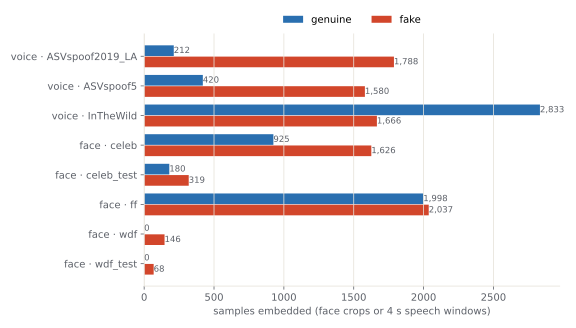
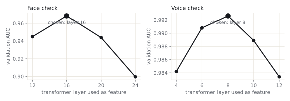
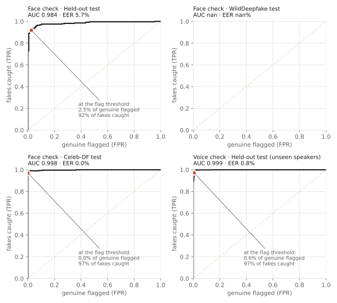
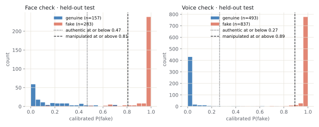
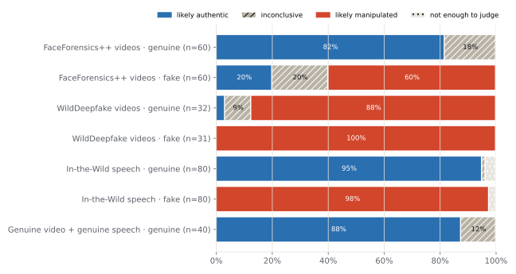

# AVDD lens: audio-visual deepfake detection

Upload a **video, voice clip or photo** and find out whether the face or the voice has been manipulated. Two independent checks run on the file: a **face check** and a **voice check**. Each is compared against thresholds set on held-out data, and the app returns one of four verdicts:

| Verdict | Meaning |
|---|---|
| **Likely authentic** | every usable check sits in the range genuine media normally falls in |
| **Inconclusive** | at least one check landed between the thresholds; check the file's source |
| **Likely manipulated** | a check crossed the threshold that at most about 2% of genuine media reaches |
| **Not enough to judge** | no usable face and no usable speech in the file |

> **Status (v2):** code, app and training pipeline are complete. The two trained model files (`src/avdd/assets/visual_head.npz`, `audio_head.npz`) are produced by one training run. **[docs/TRAINING.md](docs/TRAINING.md)** explains it step by step: about 2 h on a free Google Colab GPU. Until they are added the app starts, but refuses to analyse and says so.

---

## Contents
1. [Why v2](#why-v2)
2. [Features](#features)
3. [How it works](#how-it-works)
4. [Models and training data](#models-and-training-data)
5. [Results](#results)
6. [Run it](#run-it)
7. [Configuration](#configuration)
8. [API](#api)
9. [Project structure](#project-structure)
10. [Development and tests](#development-and-tests)
11. [Privacy, limits, credits](#privacy-limits-credits)

---

## Why v2

v1 flagged genuine videos as deepfakes, and its own investigation measured why:

| v1 problem | v2 fix |
|---|---|
| Face model (`Deep-Fake-Detector-v2`, undisclosed training data) scored at chance: AUC 0.50–0.55, and 43–94% of real faces were flagged | frozen **CLIP ViT-L/14** features + a classifier trained on FaceForensics++, Celeb-DF and WildDeepfake |
| Voice model (AASIST) trained only on clean studio speech; real phone or camera audio looked "spoofed" | frozen **XLS-R 300M** features + a classifier trained on ASVspoof 2019/5 and **In-the-Wild** recordings |
| Haar face detector produced false boxes | **YuNet** face detector |
| Uncalibrated scores, an untuned 0.5 threshold, mean over frames | calibrated probabilities; thresholds set on validation data for ≤ 2% genuine flagged; **median** over frames/windows |
| Two-state output (flagged / not flagged) | four verdicts including **inconclusive**, instead of a false accusation |

## Features

**Analyze**
- Drag-and-drop or picker for video, audio and images.
- Client-side checks of type and size.
- Live step-by-step progress.

**Result**
- **Evidence scale:** where the face and voice scores landed against each check's own thresholds.
- **Live replay** (files analysed in this tab): the video plays with the scored face boxed frame by frame, coloured by score.
- **Filmstrip** of the scored face crops; click one to jump to that frame.
- **Synced timelines** for face frames and voice windows, drawn over the real waveform. Hover for a time/score readout; click or use the arrow keys to scrub.
- Per-check statistics: median, range, distance from the threshold, coverage.
- **Compare** with an earlier analysis.
- Exports: **share card** PNG (no face in it), **copy summary**, **JSON**, **PDF**.

**History:** filter by verdict, delete one, clear all.

**Models:** the measured AUC, EER and false-alarm rates of the loaded models, per test set.

**Robust input handling**
- Video with no audio, audio with no speech, video with no face: each is handled explicitly. A missing stream never counts as "authentic".
- Corrupt or truncated files get a clear error instead of a verdict.

**Light "paper and ink" UI** with motion where it explains state. It respects reduced-motion settings and works at phone width.

## How it works

```
upload ─► ffprobe: what is in the file (video / audio / image)?
          ├─ video or image ─► up to 12 frames ─► YuNet finds the face ─► square crop
          │                    ─► CLIP ViT-L/14 (frozen) ─► linear head ─► calibrated P(fake) per frame ─► median
          └─ audio track     ─► 16 kHz mono ─► 4 s windows ─► XLS-R 300M, 12 layers (frozen)
                               ─► linear head ─► calibrated P(fake) per window ─► median
verdict:  any usable check ≥ its t_fake   → likely manipulated
          every usable check ≤ its t_real → likely authentic
          otherwise                       → inconclusive
          no usable check                 → not enough to judge
```

- **"Any check" flags** because a fake can be one-sided: a cloned voice over a real video, or a face swap over the real voice.
- **The median is used** so that one blurry frame or one noisy window cannot flip the verdict.

## Models and training data

| Check | Frozen backbone | Trained here | Method from |
|---|---|---|---|
| Face | `openai/clip-vit-large-patch14`, CLS token of one hidden layer (chosen on validation) | logistic regression + Platt calibration | Ojha et al., CVPR 2023; Khan & Dang-Nguyen 2024 |
| Voice | `facebook/wav2vec2-xls-r-300m`, first 12 layers, time-averaged hidden state of one layer | logistic regression + Platt calibration | Pascu et al., Interspeech 2024 |
| Face finder | YuNet (OpenCV Zoo, 230 KB, vendored) | none | Wu et al. 2023 |

**Why frozen backbones plus a linear head?** Fine-tuning a large network on a few thousand samples overfits to the fakes it saw. A linear probe on foundation-model features is what the papers above show generalises best to unseen generators and recording conditions. It also trains in minutes once the features exist. Each head is about 1,024 weights plus calibration and thresholds, a few KB.

| Dataset | Adds | Used |
|---|---|---|
| FaceForensics++ c23 | real YouTube videos + 6 manipulation methods, compressed | 1,000 real + 1,020 fake videos, 2 frames each |
| Celeb-DF / FakeAVCeleb frames | celebrity face swaps, Wav2Lip lip-sync | all real + 2–3% of fake frames |
| WildDeepfake | internet deepfakes, real-world quality | 24 train + 20 test archives |
| ASVspoof 2019 LA / ASVspoof 5 | TTS and voice conversion; ASVspoof 5 adds codecs | 2,000 + 2,000 clips |
| In-the-Wild | real vs deepfaked speech of 58 public figures | 4,500 clips |

- **Splits:** 70 / 15 / 15 by **identity** (video ID, sequence or speaker), so no person in the test set was seen in training.
- **Training preprocessing:** the training data passes through **exactly the inference code** (YuNet crop, CLIP processor, `make_windows`), so training and runtime see identical inputs.
- Full procedure, commands, hardware and timings: **[docs/TRAINING.md](docs/TRAINING.md)**.

**Training resources (reference run):**

| | |
|---|---|
| Recommended | Google Colab free tier, T4 GPU, about 2 h end to end |
| CPU-only | 4 vCPU Xeon 2.1 GHz, 15 GB RAM: about 3.5 h of embedding; 0.9 face crops/s and 1.7 speech windows/s with 2 threads per job |
| Peak memory | about 2.5 GB per job (data is streamed in batches of 32) |
| Downloads | about 10 GB of datasets + 2.9 GB of backbones |
| Head fitting | under 5 min |

## Results

Filled in automatically by `scripts/make_report.py` from the training run: data mix, layer search, ROC curves, score distributions, end-to-end verdicts on 383 held-out files. Nothing in this section is typed by hand.

<!-- RESULTS:START (generated by scripts/make_report.py; do not edit by hand) -->
### Training data actually used



| Cache | Genuine | Fake |
|---|---|---|
| aud_ASVspoof2019_LA | 212 | 1,788 |
| aud_ASVspoof5 | 420 | 1,580 |
| aud_InTheWild | 2,833 | 1,666 |
| vis_celeb | 925 | 1,626 |
| vis_celeb_test | 180 | 319 |
| vis_ff | 1,998 | 2,037 |
| vis_wdf | 0 | 146 |
| vis_wdf_test | 0 | 68 |


### Which layer of each backbone



| Check | Layer | t_real (authentic at or below) | t_fake (manipulated at or above) |
|---|---|---|---|
| Face check | 16 | 0.469 | 0.807 |
| Voice check | 8 | 0.266 | 0.892 |


### Detection quality
Scores are aggregated per video / sequence for the face check (median over frames), per clip for the voice check.






| Check | Set | Genuine / fake | AUC | EER | Genuine flagged | Genuine cleared | Fakes flagged |
|---|---|---|---|---|---|---|---|
| Face check | Validation (thresholds set here) | 155 / 263 | 0.988 | 5.8% | 2.6% | 89.7% | 92.0% |
| Face check | Held-out test | 157 / 283 | 0.984 | 5.7% | 2.5% | 89.2% | 91.9% |
| Face check | WildDeepfake test | 0 / 34 | nan | nan% | 0.0% | 0.0% | 85.3% |
| Face check | Celeb-DF test | 36 / 300 | 0.998 | 0.0% | 0.0% | 100.0% | 97.0% |
| Voice check | Validation (thresholds set here) | 240 / 575 | 0.993 | 4.2% | 2.1% | 90.0% | 92.7% |
| Voice check | Held-out test (unseen speakers) | 493 / 837 | 0.999 | 0.8% | 0.6% | 96.5% | 97.1% |


### End to end: held-out files through the real app pipeline
Each file was run by `scripts/evaluate_folder.py`, i.e. the same probe → face/voice → verdict code the server runs.




| Set | Files | Likely authentic | Inconclusive | Likely manipulated | Insufficient evidence |
|---|---|---|---|---|---|
| FaceForensics++ videos · genuine | 60 | 81.7% | 18.3% | 0.0% | 0.0% |
| FaceForensics++ videos · fake | 60 | 20.0% | 20.0% | 60.0% | 0.0% |
| WildDeepfake videos · genuine | 32 | 3.1% | 9.4% | 87.5% | 0.0% |
| WildDeepfake videos · fake | 31 | 0.0% | 0.0% | 100.0% | 0.0% |
| In-the-Wild speech · genuine | 80 | 95.0% | 1.2% | 0.0% | 3.8% |
| In-the-Wild speech · fake | 80 | 0.0% | 0.0% | 97.5% | 2.5% |
| Genuine video + genuine speech · genuine | 40 | 87.5% | 12.5% | 0.0% | 0.0% |
<!-- RESULTS:END -->

## Run it

**Prerequisites:** Python 3.10+, Node 20+, **FFmpeg with ffprobe on PATH**, about 4 GB free RAM, and the two trained head files (see Status).

**Windows (PowerShell)**
```powershell
winget install Git.Git Python.Python.3.12 Gyan.FFmpeg OpenJS.NodeJS.LTS     # once; reopen PowerShell after
git clone -b v2-update https://github.com/Gutsyt/Multimodel_video_audio_deepfake.git
cd Multimodel_video_audio_deepfake
python -m venv .venv; .\.venv\Scripts\Activate.ps1
pip install torch --index-url https://download.pytorch.org/whl/cpu         # or the CUDA build for an NVIDIA GPU
pip install -e ".[video,hf,api]"
cd frontend; npm ci; npm run build; cd ..
python scripts/run_server.py
```

**Linux / macOS**
```bash
git clone -b v2-update https://github.com/Gutsyt/Multimodel_video_audio_deepfake.git
cd Multimodel_video_audio_deepfake
python3 -m venv .venv && source .venv/bin/activate
pip install torch --index-url https://download.pytorch.org/whl/cpu         # macOS: pip install torch
pip install -e ".[video,hf,api]"
(cd frontend && npm ci && npm run build)
python scripts/run_server.py
```

- Open **http://127.0.0.1:8000**.
- The first start downloads the two backbones (about 2.9 GB, cached afterwards). The header chip turns green, **Models ready**, after about 1–3 minutes.
- Speed on CPU: a 10 s video takes about 10–20 s. On a GPU, set `AVDD_DEVICE=cuda`.

**Frontend development (hot reload):**
```bash
python scripts/run_server.py      # terminal 1: API on :8000
cd frontend && npm run dev        # terminal 2: UI on http://localhost:5173, proxies /api to :8000
```

**Command-line tools:**

| Command | Purpose |
|---|---|
| `python scripts/diagnose_media.py clip.mp4` | verdict plus per-frame and per-window scores for one file |
| `python scripts/evaluate_folder.py --real my_real/ --fake my_fakes/` | verdict rates over folders: measure false alarms on **your own** media |
| `python scripts/check_environment.py` | checks Python, FFmpeg, RAM, GPU |

## Configuration

These are environment variables, read at server start (see `.env.example`).

| Variable | Default | Meaning |
|---|---|---|
| `AVDD_DEVICE` | `cpu` | `cpu`, `cuda` or `mps` for both models |
| `AVDD_FRAMES` | `12` | frames sampled per video |
| `AVDD_MAX_UPLOAD_MB` | `100` | upload size limit |
| `AVDD_MAX_DURATION_S` | `60` | seconds of audio/video analysed |
| `AVDD_MAX_IMAGE_MEGAPIXELS` | `40` | image size limit |
| `AVDD_MAX_PENDING` | `4` | queued analyses (one runs at a time) |
| `AVDD_HISTORY_MAX` | `200` | stored results kept |
| `AVDD_AUDIO_MODEL` / `AVDD_VIDEO_MODEL` | `xlsr` / `clip` | `none` disables a check |
| `AVDD_DATA_DIR` | `app_data` | SQLite history + temporary uploads |
| `AVDD_CORS_ORIGINS` | localhost:5173 | origins allowed when the UI is hosted elsewhere |
| `AVDD_FRONTEND_DIST` | `frontend/dist` | built UI served by the backend |
| `AVDD_ENABLE_DOCS` | `1` | interactive API docs at `/docs` |

## API

Interactive docs are at `http://127.0.0.1:8000/docs`.

| Method | Path | Purpose |
|---|---|---|
| GET | `/api/health` | process up |
| GET | `/api/ready` | 200 when models are loaded, 503 while loading |
| GET | `/api/capabilities` | model status and measured metrics, limits, accepted formats |
| POST | `/api/analyses` | upload the file as the raw body (`application/octet-stream`); returns `{id}` |
| GET | `/api/analyses/{id}` | status (`queued` / `processing` + stage / `completed` / `failed`) and the result |
| GET | `/api/analyses/{id}/report` | result as a downloadable JSON report |
| GET | `/api/analyses` | history summaries |
| DELETE | `/api/analyses/{id}` and `/api/analyses` | delete one / all finished |

```bash
curl -X POST --data-binary @clip.mp4 -H "Content-Type: application/octet-stream" http://127.0.0.1:8000/api/analyses
curl http://127.0.0.1:8000/api/analyses/<id>          # result.assessment.verdict
```

## Project structure

```
src/avdd/
  api/        FastAPI app, job queue, SQLite store, upload validation, settings
  media/      ffprobe parsing: what streams a file really contains
  audio/      decode, usability gate, 4 s windows, XLS-R detector (ssl_detector.py)
  video/      frame sampling, YuNet faces (faces.py), CLIP detector (clip_detector.py)
  fusion/     assessment.py: per-check thresholds -> verdict
  pipeline/   analyze.py: file -> result JSON
  common/     evidence types, calibrated linear head (head.py), model cards
  assets/     YuNet ONNX + trained heads (*_head.npz)
frontend/     React 19 + Vite + TypeScript + Motion; pages/ and components/
scripts/      run_server, train_heads, download_data, build_test_sets, evaluate_folder, make_report, diagnose_media
notebooks/    train_colab.ipynb: one-click training on Google Colab
docs/         TRAINING.md, TESTING.md, deployment.md, figures/
tests/        unit + integration (test doubles), real_models (real weights)
```

## Development and tests

```bash
pip install -e ".[video,hf,api,train]" -r requirements-dev.txt
python -m pytest -q -m "not real_models"      # 113 backend tests with stand-in detectors
python -m pytest -q -m real_models            # wiring check with the real trained heads
ruff check . && mypy
cd frontend && npm run typecheck && npm test && npm run build
```

- CI (`.github/workflows/ci.yml`) runs the same checks.
- A full manual checklist of every feature, with test files to create, is in **[docs/TESTING.md](docs/TESTING.md)**.

| Document | For |
|---|---|
| [docs/TRAINING.md](docs/TRAINING.md) | training on Colab or a laptop, success criteria, handing results back |
| [docs/TESTING.md](docs/TESTING.md) | feature checklist |
| [docs/deployment.md](docs/deployment.md) | running it as a service |
| [notebooks/train_colab.ipynb](notebooks/train_colab.ipynb) | the Colab notebook |

## Privacy, limits, credits

**Privacy**
- The upload exists only as a temporary file while it is analysed, and is deleted afterwards.
- Only the result JSON is kept, with no media and no file name.
- The in-page replay uses the copy already in your browser tab and is never uploaded again.
- Nothing goes to third parties except the one-time model download from Hugging Face.
- There is no login, so don't expose the server publicly without a proxy that adds authentication (see `docs/deployment.md`).

**Limits**
- Results are evidence, not forensic proof.
- The face check looks at single frames, with no lip-sync or temporal model.
- New generators and heavy filters can evade it.
- The voice check needs speech.
- Accuracy on media unlike the training sources may differ from the Results section. Measure your own with `evaluate_folder.py`.

**Credits:** models, datasets and licences are listed in [ATTRIBUTIONS.md](ATTRIBUTIONS.md). The dataset terms restrict use to research.
